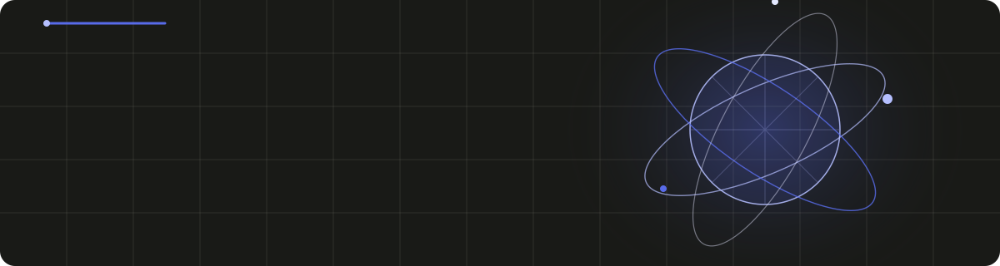

> “Build with clarity, design with care, and make every idea more useful.”

# Hi, I’m Pornput

**Pornput Sooduppatham · Software Engineer · IT at KMUTT · GPA 3.80**

I’m drawn to the point where research, product decisions, and engineering meet. I like understanding a workflow first, then building clear, useful software around it. My interests include UX research, AI and LLM applications, software architecture, product development, and creative technology.

## Languages

## Tech Stack

### Frontend

### Backend

### Database & ORM

### Hosting

### IDE & Utilities

### Design

### Operating Systems

### Tools

## Contact

